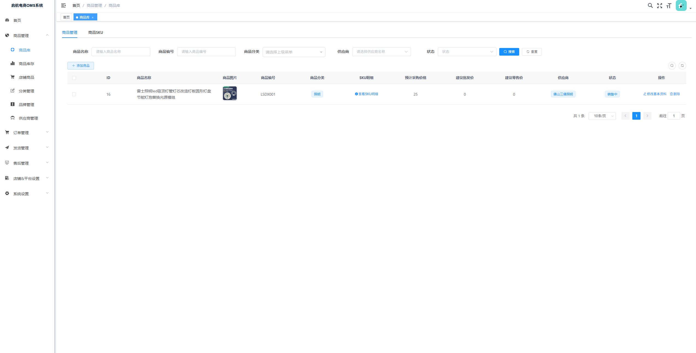
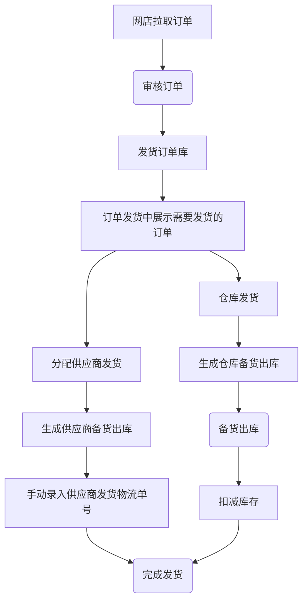
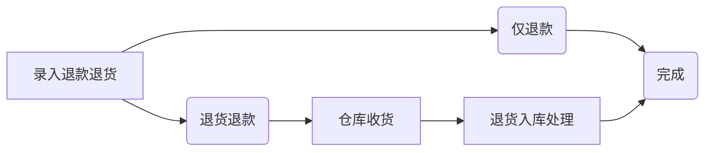
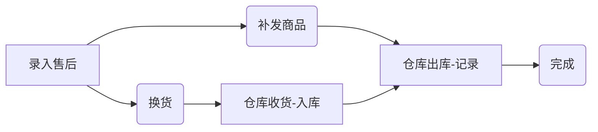
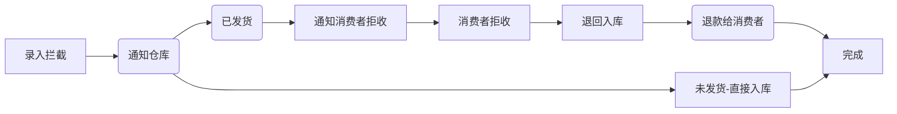

# ysmERP电商OMS系统3.0版
> **欢迎来到我们的开源项目！创新、协作、高质量的代码。您的Star🌟，是我们前进的动力！ 💪✨🏆**

> **项目持续更新中，还有很多不足，请多包含！如有任何疑问请提交issue！谢谢！ 💪✨🏆**

## 🎉 3.0版本重大升级

ysmERP 3.0版本全新发布！带来了多项重大升级，为您的电商订单管理提供更强大的支持。

### 🌟 核心升级亮点

| 升级项 | 说明 |
|--------|------|
| **多商户架构** | 支持多租户数据隔离，店铺归属商户管理 |
| **自动任务系统** | 订单自动拉取，无需手动操作 |
| **统一数据结构** | 采用企业版数据结构，底层架构升级 |
| **前端Vue2升级** | 底层框架升级，UI界面看齐企业版 |
| **AI智能分析** | 销售分析、库存优化、客户洞察等AI功能 |
| **多平台扩展** | 新增快手、小红书平台支持 |


---

## 一、系统介绍

ysmERP电商OMS系统是一个完整开箱即用的开源电商OMS系统，经历多个版本的迭代优化和客户使用验证。开发者可以直接部署即可使用。

ysmERP电商OMS系统专注核心订单处理业务，主体功能包括：商品管理、店铺商品管理、订单库、店铺订单管理、发货管理（支持仓库发货、供应商发货）、售后管理、库存管理等。

与此同时该系统会陆续增加供外部调用的API，以便开发者满足自己的个性化业务需求。

ysmERP电商ERP系统支持：淘宝天猫、京东、拼多多、抖店、微信小店、快手、小红书等平台，后续将继续对接其他电商平台。



## 二、主体功能

主体功能包括：
+ 商品管理：商品库管理、店铺商品管理（拉取店铺商品、ERP关联）。
+ 订单管理：店铺订单同步、管理、自动拉取。
+ 发货管理：电子面单打印、发货记录、物流跟踪等。
+ 售后管理：店铺售后同步、售后处理（补发、换货、退货处理）等。
+ 店铺&平台参数设置：店铺管理、商户管理、平台参数设置。

**基本上覆盖了电商网店管理日常业务，可使用接口对接内部ERP系统。**

**订单打单（电子面单打印）已支持：淘宝、京东、拼多多、抖店、微信小店**

## 三、功能模块

#### 1、商品管理
+ 商品库：管理商品库商品，提供手动录入、API接收功能，可以设置自己发货还是供应商发货（影响到后台分单逻辑，即时生效）。
  + 商品Sku：查看所有商品库SKU
+ 库存管理：支持手动修改库存（备货出库之后会扣减库存）
+ 店铺商品：店铺商品管理，店铺商品API拉取、店铺商品API更新（进行店铺商品与商品库商品关联，根据SKU编码关联）。
+ 分类管理：分类及分类属性管理（规格属性是用来组合Sku的）
+ 品牌管理
+ 供应商管理

#### 2、订单管理
+ 发货订单库：需要发货的订单查询，发货订单明细查询。
+ 店铺订单管理：订单API拉取、订单API更新、订单确认（确认之后订单进入发货订单库）等，支持淘宝天猫、京东、拼多多、抖店、微信小店、快手、小红书。
+ 订单拉取日志：记录店铺订单每次拉取日志。
+ 折扣管理：折扣活动配置

#### 3、发货管理
+ 订单发货：处理待发货的订单，支持手动发货、分配给供应商发货。
  + 手动发货：手动填写物流单号进行发货，手动发货之后将进入备货出库中。
  + 供应商发货：分配给供应商发货，分配之后将进入备货出库中；
  + 云仓发货：推送订单至云仓发货（钩子功能）

+ 电子面单发货：支持快递打印、发货、补单等功能。
+ 备货出库：已发货、已分配给供应商发货、电子面单打印快递单完成都会加入备货清单，提供给仓库备货查询。备货单可以生成出库单。
  + 供应商备货支持手动填写物流单号，实现发货。
  + 仓库备货出库：备货出库之后将扣减库存。
+ 发货记录：发货记录，提供手动发货功能。
+ 发货设置：设置发货快递、电子面单账户等信息
  + 快递公司管理：管理发货的快递公司（支持从平台拉取、支持手动添加）。
  + 电子面单账户设置：管理店铺开通的电子面单账户

#### 4、售后管理
+ 售后中心：聚合售后查询、详情、管理。
+ 店铺售后管理：售后API拉取、售后API更新、手动推送、售后操作（同意、备注）。
+ 售后处理记录：售后处理的记录查询，提供手动售后处理功能。
+ 售后台账：售后统计台账

#### 5、店铺&平台设置
+ 店铺管理
+ 商户管理（多租户）
+ 平台开关
+ 接口授权
+ 定时任务配置
+ 平台拉取日志
+ 快递公司库

#### 6、系统设置
+ 用户管理
+ 菜单管理
+ 角色管理
+ 部门管理
+ 字典管理

## 四、技术文档

> 👉 **详细技术文档请参考：[OMS3.0架构文档](OMS3.0_ARCHITECTURE.md)**

技术文档包含：
- 技术架构设计
- 核心功能实现
- 业务流程图
- API接口规范
- 代码规范
- 扩展建议

## 五、主要流程

### 1 发货流程

**订单发货流程**


### 2 售后处理流程

**退货退款流程**


**售后流程**


**订单拦截**


## 六、部署说明

#### 0 版本说明
+ Java：17
+ Nodejs：v16
+ SpringBoot:3
+ MySQL:8
+ Redis:7

#### 1 配置MySQL

+ 创建数据库`ysmERP`
+ 导入数据库结构：sql脚本`docs\ysmERP.sql`

#### 2 启动Redis

#### 3 修改项目配置

+ 修改`api`项目中的配置文件`application.yml`配置`Mysql`相关配置。

#### 4 mvn打包部署
+ Java版本：`Java 17`
+ Maven版本：`3.8`
  `mvn clean package`

#### 5 前端 `vue`打包
+ nodejs版本要求：`v16.x`
+ 安装依赖：`npm install --registry=https://registry.npmmirror.com`
+ 打包`npm run build:prod`

#### 6 修改Nginx配置

```
# 前端web配置
location / {
        root /usr/share/nginx/html;
        index  index.html index.htm;
        try_files $uri $uri/ /index.html;
    }

location /prod-api/ {
    proxy_set_header Host $http_host;
    proxy_set_header X-Real-IP $remote_addr;
    proxy_set_header REMOTE-HOST $remote_addr;
    proxy_set_header X-Forwarded-For $proxy_add_x_forwarded_for;
    proxy_pass http://localhost:8086/;
}
```

#### 7 访问web
+ 访问地址：`http://localhost`
+ 登录名：`admin`
+ 登录密码：`Andy@2025`

## 七、一键部署（推荐）

> 全自动部署到 Linux 服务器（对齐 3x-ui 部署体系）：自动安装 JDK17/MySQL8/Redis/Nginx、创建 swap、生成随机数据库密码、从 GitHub Release 下载产物并做 sha256 校验、注册 systemd 服务（开机自启/崩溃自恢复/内存限额）、配置 Nginx 站点并放行防火墙。

### 7.1 环境依赖要求

| 项 | 要求 |
|---|---|
| 服务器系统 | Ubuntu 20.04/22.04/24.04、Debian 11+、Rocky / AlmaLinux / CentOS Stream 8+（已适配甲骨文免费机 1C1G，自动创建 2G swap） |
| 服务器权限 | root 或 sudo 免密（脚本自动提权） |
| 网络 | 服务器可访问 GitHub（海外机直连即可） |
| GitHub Release | 仓库已通过 tag（如 `v1.0.0`）触发 Actions 构建并发布产物 |
| 本地（方式一需要） | Windows 自带 OpenSSH；仓库私有则需 `ghp_` 只读 PAT |
| 云安全组 | 甲骨文云需在控制台「安全列表」放行对外端口 TCP 30545（系统内 iptables 由脚本自动处理） |
| 可选 | 已解析到服务器 IP 的域名（无域名可用 IP 访问） |

### 7.2 部署命令

**方式〇：SSH 终端一键直达（3x-ui 同款，推荐）**

适用场景：拿到全新 Linux 服务器后，在 FinalShell / Xshell / Tabby 等 SSH 终端中**一条命令、零文件上传**完成全部部署（自动装依赖 → 配置服务 → 开机自启 → 输出访问信息）。

注意事项：

- 命令经管道执行，自动进入**全默认非交互模式**（仓库 `YSM1987/ysmERP`、IP 访问、对外端口 30545、后端端口 8086）；如需绑定域名请改用方式一/二
- 仓库为私有（当前状态）必须带 `GITHUB_TOKEN`（[生成只读 token](https://github.com/settings/tokens)，classic 勾 `repo` 即可）；若仓库已设 Public 可用免 token 命令
- 全程约 3-8 分钟（视网络），中途请勿断开 SSH

私有仓库（复制后把两处 `ghp_xxx` 替换为你的 token）：

```bash
GITHUB_TOKEN=ghp_xxx bash <(curl -Ls -H "Authorization: Bearer ghp_xxx" https://raw.githubusercontent.com/YSM1987/ysmERP/master/deploy/install.sh)
```

Public 仓库（免 token，与 3x-ui 体验一致）：

```bash
bash <(curl -Ls https://raw.githubusercontent.com/YSM1987/ysmERP/master/deploy/install.sh)
```

预期输出（安装结束自动打印）：

```
======================================================================
 安装完成！
 访问地址   : http://服务器IP:30545
 默认账号   : admin / Andy@2025（登录后请立即修改密码）
 MySQL 密码 : 已写入 /etc/ysmERP/application.yml 与 install-result.env
 Redis 密码 : 已写入 /etc/ysmERP/application.yml
 安装版本   : v1.0.x
 管理命令   : ysmERP（start/stop/restart/status/log/update/uninstall/settings）
 后续更新   : ysmERP update
======================================================================
部署验证（依次执行以下命令确认服务正常）：
  ...
```

**方式一：本地 Windows 一键部署（全程不进服务器，支持绑定域名）**

```powershell
powershell -ExecutionPolicy Bypass -File .\deploy\one-key-deploy.ps1 `
  -ServerIP 服务器公网IP `
  -GithubRepo 你的用户名/ysmERP `
  -Domain 你的域名 `
  [-GithubToken ghp_xxx 私有仓库必填] `
  [-WebPort 30545 对外端口，默认 30545]
```

**方式二：服务器交互式（SSH 登录后执行）**

```bash
# 1. 上传 deploy/ 目录至服务器（scp -r deploy root@服务器IP:/root/oms-deploy）
# 2. 执行安装（按提示输入仓库/域名/端口，回车取默认值）
sudo bash /root/oms-deploy/install.sh
```

**方式三：非交互一行命令（CI / 脚本自动化）**

```bash
YSMERP_NONINTERACTIVE=1 \
GITHUB_REPO=你的用户名/ysmERP \
GITHUB_TOKEN=ghp_xxx \
DOMAIN=你的域名 \
WEB_PORT=30545 \
bash install.sh
```

**方式四：甲骨文实例开机自动部署（cloud-init）** —— 创建实例时在「高级选项 → 用户数据」粘贴 `deploy/cloud-init/cloud-init.yaml`（先改文件头部仓库/域名/Token 三项），开机即完成全部部署。

**安装完成后**：访问 `http://服务器IP:30545`（默认账号 `admin / Andy@2025`，登录后立即改密）；密码与配置见 `/etc/ysmERP/application.yml`；服务器端管理命令 `ysmERP`（start/stop/restart/status/log/update/uninstall）。**重复执行 install.sh 或运行 `ysmERP update` 即为更新到最新 Release。**

**部署验证**（SSH 终端依次执行，确认服务正常启动运行）：

```bash
# 1. 服务状态 —— 应显示 active (running)
ysmERP status

# 2. 后端接口 —— 应输出 200
curl -s -o /dev/null -w '%{http_code}\n' http://127.0.0.1:8086/captchaImage

# 3. Nginx 反代 —— 应输出 200；浏览器打开 http://服务器IP:30545 应看到登录页
curl -s -o /dev/null -w '%{http_code}\n' http://服务器IP:30545/captchaImage

# 4. 开机自启 —— reboot 后再次执行 ysmERP status 仍为 active 即生效
```

异常排查：`ysmERP log`（应用日志）、`journalctl -u ysmERP -n 50`（系统日志）、`nginx -t`（站点配置），更多见下方 7.3。
